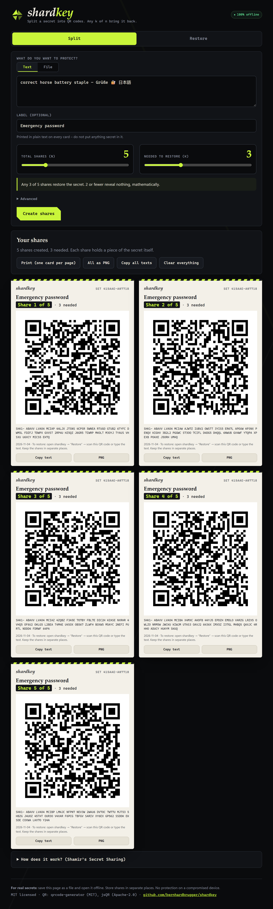
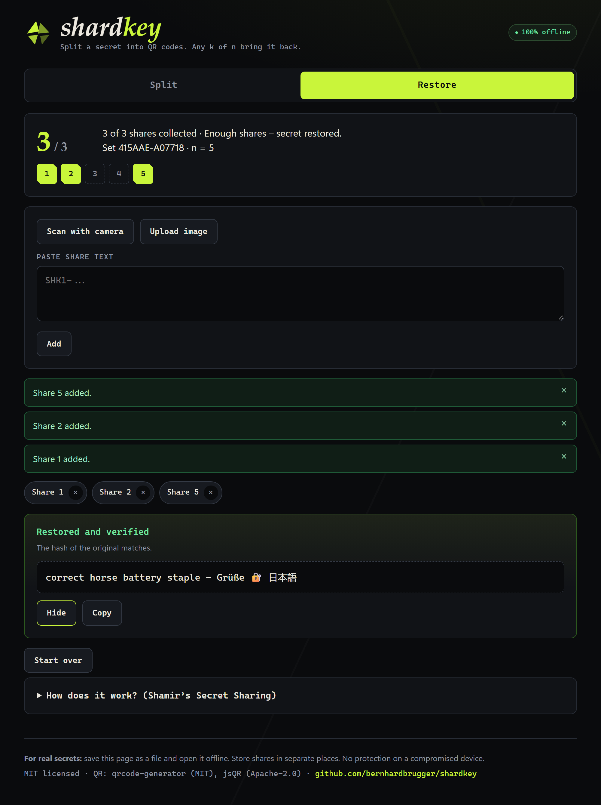

# shardkey

**Split a secret into QR codes. Any *k* of *n* bring it back. One offline HTML file.**

[](https://github.com/bernhardbrugger/shardkey/actions/workflows/ci.yml)
[](LICENSE)

**▶ Live demo: <https://bernhardbrugger.github.io/shardkey/>** (for real secrets, download the page and use it offline - see [Security notes](#security-notes-and-limits))

<!-- Demo GIF placeholder: record a short screen capture to docs/demo.gif, then uncomment the next line. -->
<!--  -->

| Split | Restore |
|---|---|
|  |  |

shardkey takes a password, a recovery seed, a note or a small file and cuts it into *n* **shares**
using [Shamir's Secret Sharing](https://en.wikipedia.org/wiki/Shamir%27s_secret_sharing). Any *k* shares
restore the secret exactly. **Fewer than *k* shares reveal nothing - not "very little", mathematically nothing.**
Every share comes as a QR code plus text, and as a printable card (one per page).

* **One file.** `index.html` contains all HTML, CSS and JavaScript. No build step, no CDN, no fonts, no analytics.
* **Offline by construction.** A Content-Security-Policy (`connect-src 'none'`, no `unsafe-inline`, no `unsafe-eval`)
  makes the browser refuse every network request, even if the code were buggy or tampered with later.
* **Auditable.** The Shamir part (GF(256) arithmetic, split, combine) is about 100 commented lines at the top of the `shk-core` script block.
  Shamir is implemented from scratch over GF(256); randomness comes only from `crypto.getRandomValues`.
* **Tested.** Every *k*-subset for a dozen (k, n) combinations, a chi-square independence test, format and tamper tests,
  and end-to-end tests in real Chromium that split in the UI, read the rendered QR codes back with an independent
  decoder (also through a fake webcam) and restore the secret.

## Use cases

* **Emergency password for the family.** Split your password-manager master password 3-of-5: a card each for partner,
  sibling, lawyer, safe deposit box, your desk. No single person (or burglar) can read it, any three can.
* **Backing up recovery codes and seeds.** Cut a 2FA recovery list or a wallet seed into shares and store them in
  different places, so a single fire, theft or lost drawer does not decide.
* **Team break-glass access.** Any 2 of 4 admins can unlock the root credentials; no admin can do it alone.
* **Dead-man's switch for documents.** Encrypt a file, keep the ciphertext anywhere, hand out key shares.

## Using it

1. Download `index.html` (the live demo has a button) and open it in a browser - from disk, no server needed.
2. **Split:** type a secret or choose a file, set *n* (total shares) and *k* (needed), optionally add a label, press
   *Create shares*. Print the cards, save the PNGs, or copy the texts. Then **clear everything** and close the tab.
3. **Restore:** open the page, switch to *Restore*, scan the QR codes with the camera, upload photos or screenshots of
   them, or paste the text. The counter shows "2 of 3 shares collected"; with the third share the secret appears
   (hidden until you click *Reveal*; files are offered as a download).

## How Shamir's Secret Sharing works (in plain words)

Two points determine exactly one straight line. Three points determine exactly one parabola. *k* points determine
exactly one polynomial of degree *k − 1*.

shardkey picks a **random polynomial of degree k − 1 whose value at x = 0 is your secret**. Share number *i* is the point
on the curve at x = *i*. With *k* points you can reconstruct the curve and read off the value at 0.
With only *k − 1* points, *every* possible secret has exactly one curve that fits, all equally likely - so the shares
carry no information about the secret at all (the page has an interactive picture of this).

The real thing computes in the finite field **GF(2⁸)** instead of with real numbers, one byte of the secret at a time, so a share is
exactly as large as the secret and nothing is lost to rounding.

## Modes: direct and AES

| | when | what is shared | QR content |
|---|---|---|---|
| **direct** | the shares fit in a QR code (about ≤ 400 bytes: passwords, seeds, notes) | the secret itself | one share per QR code |
| **AES** | larger secrets and files (up to 25 MB in the UI), or forced in *Advanced* | a random 256-bit key; the content is encrypted with **AES-256-GCM** | key share per QR code; the ciphertext goes into a separate `.shkc` file |

In AES mode the ciphertext is embedded into every share when it fits into a QR code (only reachable by forcing AES mode
for small input, since a direct share is always smaller); otherwise you download one `.shkc` file and keep it anywhere
(cloud, USB stick). It is useless without *k* shares. Restoring needs *k* shares plus that file.

## Share format (version 1)

A share is a text string: `SHK1-` + **Base32** (RFC 4648 alphabet `A-Z2-7`, no padding).
Upper-case Base32 fits QR *alphanumeric* mode (5.5 bits per character) and avoids look-alikes (no `0/O`, `1/l`).
Parsing ignores case, spaces, line breaks and extra hyphens, so cards can be typed in groups.

Binary layout before Base32:

| offset | size | field |
|---|---|---|
| 0 | 1 | flags: bit 0 = payload is an AES key, bit 1 = ciphertext embedded; other bits must be 0 |
| 1 | 6 | **set id**, random, identical in all shares of one split |
| 7 | 1 | `((k − 1) << 4) \| (n − 1)`, so 2 ≤ k ≤ n ≤ 16 |
| 8 | 1 | **share index** `x`, 1…n (x = 0 would be the secret and is never used) |
| 9 | L | Shamir share bytes. Direct: `len(payload) + 8`. AES: 40 (32-byte key + 8-byte hash) |
| 9+L | … | AES with embedded ciphertext only: `iv(12) ‖ ciphertext ‖ GCM tag(16)` |
| end−4 | 4 | **CRC-32** of everything before it (big endian): catches typos and scan errors |

The *shared* payload (what Shamir splits) is

```
direct:  type(1) | [file: nameLen(1) name] | data | hash8        type 0 = UTF-8 text, 1 = file
AES:     key(32) | hash8                                          plaintext = type | [name] | data
```

`hash8` is the first 8 bytes of SHA-256 of the content (direct: everything before it; AES: the plaintext).
Because it is part of the *shared* bytes it reveals nothing below *k* shares, yet after reconstruction it verifies the
result: wrong, mixed-up or corrupted shares are detected instead of silently producing garbage.

Ciphertext file `.shkc`: `"SHKC" | version(1) | set id(6) | iv(12) | ciphertext+tag | CRC-32`. AES-GCM uses the
additional data `"SHK1" ‖ set id`, which binds a ciphertext to its set.

When combining, shardkey reports in plain language: not a share, unsupported version, invalid character (with position),
checksum mismatch, shares from different sets (with both ids), duplicate or conflicting indices, too few shares
("2 of 3"), missing or wrong ciphertext file, and failed verification.

### Design decisions

* **GF(256) with the AES polynomial 0x11B**, generator 3, log/exp tables. Shares use the x-coordinates 1…n.
* **Max 16 shares.** Keeps the header at 9 bytes and the cards manageable; k and n share one byte.
* **Hash inside the secret, CRC outside.** CRC-32 per share is for human errors; `hash8` inside the payload proves the result.
* **QR size cap of 700 characters** per share (QR version ≤ 17, error correction M): comfortable to scan from paper. A typical
  password share is a 33×33 QR code. Above the cap shardkey switches to AES mode automatically.
* **The label is not in the share.** It is printed on the card only, so a share does not leak what it protects.
* **The first k shares (by index) are used** when more are supplied; the UI lets you remove a share you distrust.

## Security notes and limits

* **Use the offline file for real secrets.** A hosted copy has to be trusted not to change. Download `index.html`,
  disconnect or just open it from disk. You can read the whole file (or `git diff` releases) before using it.
* **A compromised device defeats everything.** Malware, keyloggers, hostile browser extensions, screen capture and
  clipboard managers see your secret while you type it or when it is restored. Use a clean, trusted machine.
* **Keep shares apart.** *k* shares in one drawer are one secret in one drawer. Choose *k* and the hiding places so that
  neither loss (too few left) nor collusion (k holders) is likely.
* **No share authentication.** shardkey detects accidental damage and mix-ups, not a malicious share holder who hands you a
  deliberately forged share with a valid checksum - verification will fail, but it cannot tell you *who* cheated.
  (This is plain Shamir, not verifiable secret sharing.)
* **What a share does reveal.** Its set id, *k*, *n*, its index, and - in direct mode - the *length* of the secret.
  The label on a printed card is plain text.
* **Two different guarantees.** Direct mode is information-theoretically secure below k shares. In AES mode the *key* is
  protected that way, but the content is only as strong as AES-256-GCM, so the `.shkc` file is safe to store openly only to that extent.
* **Browser memory is not wiped reliably.** JavaScript cannot guarantee that secrets are erased; *Clear everything* removes
  them from the page, closing the tab ends the session. Printing leaves traces in spoolers and printer memory.
* **Randomness** is `crypto.getRandomValues` only (the test suite asserts that `Math.random` never appears in the core).
* This project has **not had a professional security audit.** The core is deliberately short to make yours easy.

## Development

```bash
npm install            # dev dependencies only: jsqr, pngjs, playwright, qrcode-generator (the app has no dependencies)
npm test               # GF(256), Shamir, chi-square, format, CSP/vendoring checks (seconds)
npx playwright install chromium
npm run test:e2e       # real-browser end-to-end tests; writes screenshots to docs/screenshots
npm run seal           # after editing index.html: refresh vendored libraries + CSP hashes
```

`index.html` is the product; there is nothing to build. The only maintenance step is `npm run seal`: because the CSP
allows scripts and styles by SHA-256 hash (no `unsafe-inline`), the hashes in the `<meta>` tag must match the inline blocks,
and the vendored libraries must equal the pinned npm packages. `npm test` fails if either is out of date.

CI (`.github/workflows/ci.yml`) runs all tests on every push and deploys `index.html` to GitHub Pages from `main`.

## Credits

* [qrcode-generator](https://github.com/kazuhikoarase/qrcode-generator) by Kazuhiko Arase - MIT. QR code generation.
* [jsQR](https://github.com/cozmo/jsQR) by Cosmo Wolfe - Apache-2.0. QR detection fallback; the browser's
  `BarcodeDetector` API is used first when available.
* Adi Shamir, *How to share a secret*, Communications of the ACM, 1979.

Full license texts: [THIRD_PARTY_LICENSES.md](THIRD_PARTY_LICENSES.md). "QR Code" is a registered trademark of DENSO WAVE INCORPORATED.

## License

[MIT](LICENSE)
